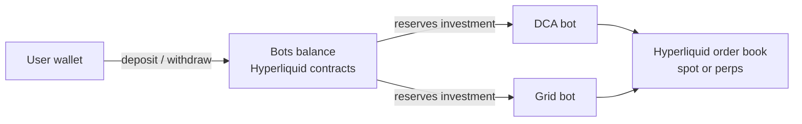
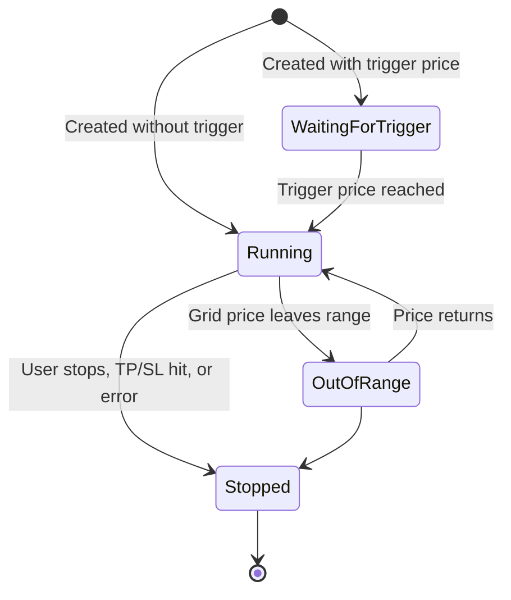

  <picture>
    <source media="(prefers-color-scheme: dark)" srcset="https://docs.dyxy.io/logo/dark.svg">
    
  </picture>

# DYXY Trading bots

How DYXY's DCA and Grid bots work: strategy logic, parameters, formulas and worked examples. Bots run on spot or futures and execute on Hyperliquid.

> This repository describes how the product works. It does not contain DYXY source code. User guide: [docs.dyxy.io/bots](https://docs.dyxy.io/bots/overview).

## Strategies

| | DCA bot | Grid bot |
| --- | --- | --- |
| Market condition | Pullbacks within a broader trend | Sideways, ranging markets |
| How it profits | Averages into a position, exits on the rebound | Buys low and sells high on every grid step |
| Key settings | Price deviation, safety orders, take profit | Price range, number of grids, grid type |
| Main risk | Long trend against the position | Price leaving the range |
| Details | [docs/dca.md](docs/dca.md) | [docs/grid.md](docs/grid.md) |

## Execution and funds

- Bots trade from a dedicated **bots balance** held in Hyperliquid contracts, separate from the perps and Degen balances.
- Creating a bot reserves its investment from the bots balance. Stopping it releases unused funds back to the bots balance.
- Every bot runs on **spot** (long only, no liquidation) or **futures** (long, short or neutral, with leverage).

## Spot or futures

| | Spot | Futures |
| --- | --- | --- |
| Trades | The asset itself | Perpetuals on the asset |
| Direction | Long | Long, short, neutral (grid) |
| Leverage | None | Adjustable |
| Liquidation | None | Possible |
| Funding | None | Paid or received while a position is open |

## Lifecycle

On stop the user chooses to **close the position** at market or **keep the position** in the bots balance. Open orders are always cancelled.

## Fees

The standard DYXY trading fee applies to every order a bot fills, 10% lower with a referral code. Futures bots also pay or receive funding. There is no subscription and no fee for creating or stopping a bot.

## License

Text and diagrams in this repository are licensed under [CC BY 4.0](LICENSE). The DYXY name and logo are not covered by this license.
