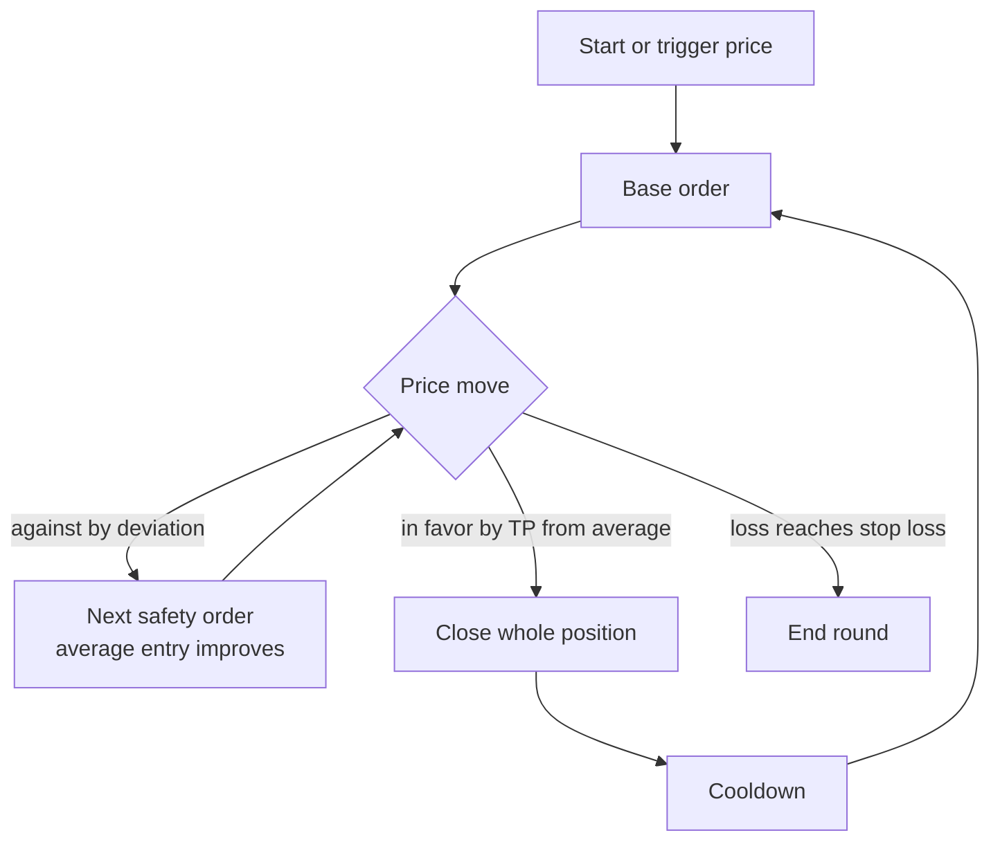

# DCA bot

The DCA bot opens a position with a **base order**, adds **safety orders** as the price moves against it, and closes the whole position at a **take profit** measured from the average entry. Then a new round begins.

## Round



## Parameters

| Parameter | Meaning |
| --- | --- |
| Direction | Buy (long) or sell (short) |
| Base order | Size of the first order in each round |
| Safety order | Size of the first safety order |
| Max safety orders | Safety orders allowed per round |
| Price deviation | Move from the base order that triggers the first safety order |
| Safety order size multiplier | Each next safety order = previous × multiplier |
| Price deviation multiplier | Each next gap = previous gap × multiplier |
| Take profit | Target from average entry. Fixed or trailing |
| Stop loss (optional) | Loss from average entry that ends the round, optionally the bot |
| Trigger price (optional) | Bot starts only when price reaches it |
| Price range (optional) | Range in which a new base order may open |
| Leverage (perp) | Multiplies size and risk |

## Formulas

Safety order sizes, with size multiplier `m`:

```
SOₙ = SO₁ × mⁿ⁻¹
total investment = base order + Σ SOₙ
```

Safety order levels, with deviation `d` and deviation multiplier `k` (buy side):

```
gap₁ = d
gapₙ = gapₙ₋₁ × k
levelₙ = base price × (1 − (gap₁ + … + gapₙ))
```

Average entry and take profit (buy side):

```
average entry = total quote spent ÷ total base bought
TP price      = average entry × (1 + take profit)
```

## Worked example

ETH at $4,000 · base $100 · safety order $100 · multiplier 1 · max 2 · deviation 5% · TP 3%

| Step | Price | Bought | Invested | Average entry |
| --- | --- | --- | --- | --- |
| Base order | $4,000 | 0.0250 ETH | $100 | $4,000 |
| Safety order 1 | $3,800 | 0.0263 ETH | $200 | ≈ $3,899 |
| Safety order 2 | $3,600 | 0.0278 ETH | $300 | ≈ $3,793 |

TP at ≈ $3,907. Selling 0.0791 ETH returns ≈ $309, a profit of ≈ $9 before fees, although the price never returned to $4,000.

## Tuning

| Setting | Effect |
| --- | --- |
| Tighter deviation, more safety orders | Fills and exits sooner, budget runs out faster in deep drops |
| Deviation multiplier > 1 | Keeps capacity for larger drops |
| Size multiplier > 1 | Average entry falls fast, later orders grow fast |
| Perp | Each safety order increases size and moves the liquidation price; check the worst case with all safety orders filled |
