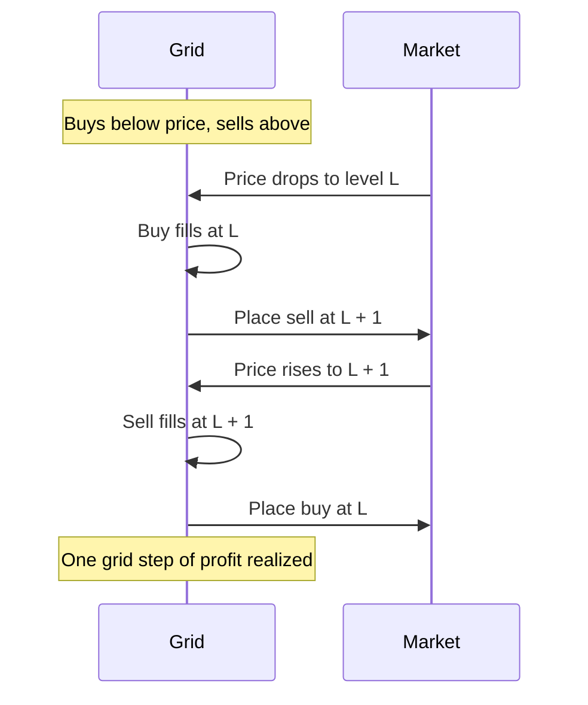

# Grid bot

The grid bot splits a price range into levels and keeps a limit order at each one: buys below the current price, sells above it. Each time the price crosses a level and comes back, one grid step of profit is locked in.

## Mechanics



If the price leaves the range, the bot pauses trading until it returns, unless a stop condition ends it.

## Parameters

| Parameter | Meaning |
| --- | --- |
| Lower and upper price | Range covered |
| Number of grids | Levels in the range |
| Grid type | Arithmetic (fixed step in price) or geometric (fixed step in percent) |
| Investment | Total funds, divided across levels |
| Mode (futures) | Neutral, long or short |
| Leverage (futures) | Multiplies order sizes and risk |
| Trigger price (optional) | Starts the bot at a set price |
| TP / SL (optional) | Stops the bot at a price or a total profit or loss |
| Close position on stop | Sell holdings or close the futures position when stopping |

## Formulas

With lower price `P_low`, upper price `P_high` and `N` grids:

```
Arithmetic:  step = (P_high − P_low) ÷ N
             levelᵢ = P_low + i × step

Geometric:   ratio = (P_high ÷ P_low)^(1/N)
             levelᵢ = P_low × ratioⁱ
```

Profit per grid, before fees:

```
Arithmetic:  step ÷ buy price   (larger in % at the bottom of the range)
Geometric:   ratio − 1          (equal in % across the range)
```

The profit per grid must stay well above the trading fee for one buy and one sell.

## Arithmetic or geometric

| | Arithmetic | Geometric |
| --- | --- | --- |
| Step | Fixed amount | Fixed percentage |
| Profit per grid | Higher % at low prices | Equal % everywhere |
| Best for | Narrow ranges | Wide ranges, volatile assets |

## Futures modes

| Mode | Start | Profits from |
| --- | --- | --- |
| Neutral | No position | Swings in either direction |
| Long | Opens a long | Swings plus upward drift |
| Short | Opens a short | Swings plus downward drift |

## Worked example

SOL spot grid · $180 to $220 · 20 arithmetic grids · $2,000

- Step = $2, about $100 per level
- Buy at $198, sell at $200 → ≈ 1.0% on $100 before fees
- A choppy day repeats this across many levels

## Risk

In a strong trend the grid keeps buying into a fall or selling into a rise and ends with a losing position at the edge of the range. With leverage this can end in liquidation. A stop loss below the range (spot or long) or above it (short) limits the damage.
